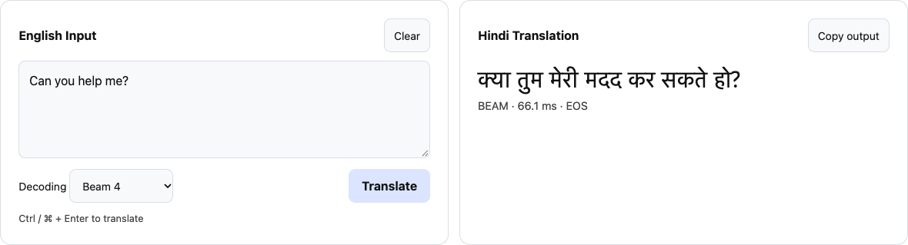

# Transformer

**English-to-Hindi neural machine translation in PyTorch**

A custom encoder–decoder Transformer trained from random initialization on synthetic conversational data. Run the frozen checkpoint locally, compare greedy and beam search, and inspect the attention tensors behind each generated sequence.

[Run locally](transformer-from-scratch/docs/GETTING_STARTED.md) · [Evaluation](#evaluation-and-results) · [Technical report](transformer-from-scratch/docs/PROJECT_REPORT.md)



## AI assistance

AI tools assisted with development, debugging, and documentation. The translation demo runs the project’s custom PyTorch model locally. Its weights were trained from random initialization, and inference uses the saved checkpoint and tokenizer.

## System architecture


The corpus generator freezes data splits and fits BPE on the training split. Training selects a checkpoint by validation loss. Offline evaluation and local serving use that checkpoint and its tokenizer. The browser calls the Python inference server and renders its predictions and diagnostic tensors.

## Inside the Transformer

For each head, **Attention(Q, K, V) = softmax(QKᵀ / √dₖ)V**. The implementation masks blocked scores before softmax and gives fully masked rows zero attention. Each of the four heads projects into 32 channels. Head outputs are concatenated and projected back to width 128.

| Attention | Queries | Keys and values | Visible keys |
|---|---|---|---|
| Encoder self-attention | English | English | Non-padding source positions |
| Decoder self-attention | Hindi prefix | Hindi prefix | Non-padding positions up to the current query |
| Cross-attention | Hindi prefix | Encoder states | Non-padding source positions |

Cross-attention weights have shape `[batch, heads, target_length, source_length]`. Fixed sine and cosine features give token embeddings position information. Each block applies residual addition and post-layer normalization around its attention and position-wise ReLU feed-forward sublayers. At inference, the decoder starts with BOS and feeds its predictions back until EOS or the length cap. [Architecture and tensor flow](transformer-from-scratch/docs/ARCHITECTURE.md)

## Model specifications

| Component | Released checkpoint |
|---|---|
| Architecture | Encoder–decoder Transformer, post-norm |
| Trainable parameters | 1,126,656 |
| Encoder / decoder blocks | 2 / 2 |
| Attention | 4 heads per layer, 32 channels per head |
| Hidden / feed-forward width | 128 / 384 |
| Tokenizer | Shared byte-level BPE, 874 tokens |
| Maximum sequence length | 64 positions |
| Initialization | Random weights |
| Released checkpoint | Epoch 11, optimizer step 1,980 |
| Demo decoding | Greedy and beam search with width 4 |

## Training methodology

The generator produced 8,597 training pairs from a controlled conversational grammar. The split policy keeps normalized source and target strings and semantic groups disjoint. Composition and lexical test sets recombine familiar constructions. The structure test set withholds entire question families.

Teacher forcing pairs the shifted Hindi prefix with next-token labels. Padding labels are excluded from cross-entropy. The trainer clips gradient norms at 1.0 and updates weights with AdamW using warmup followed by inverse-square-root decay. The run stopped after 16 epochs, with epoch 11 selected by validation loss. [Training configuration](transformer-from-scratch/configs/interview_training.yaml) · [Technical report](transformer-from-scratch/docs/PROJECT_REPORT.md)

## Evaluation and results

Greedy evaluation from the frozen checkpoint. Exact match compares the whole prediction against one synthetic reference. chrF2 measures character n-gram overlap, BLEU measures token n-gram overlap with a brevity penalty, and EOS counts completed generations.

| Synthetic split | Exact match | chrF2 | BLEU | EOS |
|---|---:|---:|---:|---:|
| In-domain validation | 1,079/1,088 (99.17%) | 99.81 | 99.61 | 1,088/1,088 |
| Held-out composition | 1,621/1,642 (98.72%) | 99.68 | 99.31 | 1,639/1,642 |
| Held-out lexical combinations | 2,399/2,434 (98.56%) | 99.92 | 99.24 | 2,434/2,434 |
| Withheld structures | 330/433 (76.21%) | 87.44 | 83.24 | 428/433 |

The composition score measures recombination within the generated domain. The structure split shows a drop when entire patterns are withheld. [Evaluation history and metric sources](transformer-from-scratch/docs/EXPERIMENT_RESULTS.md)

## Application showcase

The cross-attention heatmap below comes from the beam-search translation shown above. The dashboard records greedy evaluation scores and training curves.


## Engineering challenges

- **Alignment and tokenization.** Earlier IIT Bombay audits found source–target mismatches. The controlled generator isolates specific grammar and agreement cases. Byte-level BPE preserves UTF-8 round trips, while Hindi still consumes more subword pieces than English in the recorded tokenizer sample.
- **Source conditioning.** Shuffling English increased teacher-forced loss in an earlier IIT Bombay experiment, yet generated text still lost names and numbers. The released benchmark distinguishes source-conditioned likelihood from free-running translation quality.
- **Masking and training stability.** Mask and gradient tests check future-token isolation and padding. Clipping, warmup, and validated optimizer-boundary resume cover the training path.
- **Generation and generalization.** Beam search fixes the malformed greedy help request, but both methods turn “your” into “their” in a name question. Separate composition, lexical, and structure splits reveal failures that a pooled score would obscure. [Error analysis](transformer-from-scratch/docs/PROJECT_REPORT.md)

## Run and reproduce

From the repository root, use Python 3.11 or later and Bash. The demo runs on CPU.

```bash
cd transformer-from-scratch
python3 -m venv .venv
.venv/bin/python -m pip install -r requirements.txt
shasum -a 256 -c assets/release/SHA256SUMS
.venv/bin/python -m zipfile -e assets/release/conversation-v2.zip experiments/conversation-v2-release
bash scripts/run_interview_demo.sh --experiment experiments/conversation-v2-release --port 8765
```

Open [localhost:8765](http://127.0.0.1:8765). Try **Can you help me?**, choose **Compare both**, and inspect cross-attention for the generated Hindi prefix. The archive bundles the checkpoint, tokenizer, synthetic data, evaluations, and training log. The setup guide includes commands to regenerate the scores, train in a fresh directory, and run the tests. [Getting started](transformer-from-scratch/docs/GETTING_STARTED.md) · [Artifact manifest](transformer-from-scratch/assets/release/README.md)

## Repository structure

```text
transformer-from-scratch/
├── src/
│   ├── model/       # Attention, encoder, decoder, and projection
│   ├── data/        # Corpus preparation, tokenization, and masks
│   ├── training/    # Optimization, metrics, and checkpoint resume
│   └── inference/   # Checkpoint loading and decoding
├── scripts/         # Preparation, training, evaluation, and serving
├── interview_app/   # Local web interface
├── assets/         # Frozen release and README visuals
├── tests/          # Python regression and browser smoke tests
└── docs/           # Architecture, reports, and setup
```

## Technical documentation

- [Architecture and attention](transformer-from-scratch/docs/ARCHITECTURE.md)
- [Technical project report](transformer-from-scratch/docs/PROJECT_REPORT.md)
- [Experiment results](transformer-from-scratch/docs/EXPERIMENT_RESULTS.md)
- [Interview guide](transformer-from-scratch/docs/INTERVIEW_GUIDE.md)
- [Getting started](transformer-from-scratch/docs/GETTING_STARTED.md)

## Research references

- Vaswani et al., [Attention Is All You Need](https://arxiv.org/abs/1706.03762).
- [PyTorch documentation](https://docs.pytorch.org/docs/stable/index.html) and [Hugging Face Tokenizers byte-level pre-tokenization](https://huggingface.co/docs/tokenizers/api/pre-tokenizers#tokenizers.pre_tokenizers.ByteLevel).
- [SacreBLEU](https://github.com/mjpost/sacrebleu) and [IIT Bombay English–Hindi corpus](https://www.cfilt.iitb.ac.in/iitb_parallel/), used for historical experiments.

## Limitations and future work

The demo accepts a finite set of conversational patterns. Unseen names and constructions can be rejected or mistranslated. Longer inputs face the 64-position context and the demo’s 32-token generation cap. Fixed Hindi gender and address conventions, agreement errors, and occasional repetition limit coverage. The next evaluation should use independently reviewed paraphrases, name and role contrasts, and explicit Hindi agreement and politeness labels.

## Author and links

**Keshav Kandoi** · [GitHub](https://github.com/KeshavKandoi) · [Portfolio](https://keshavkandoi.me) · [LinkedIn](https://www.linkedin.com/in/keshavkandoi/)

## License

The repository has no license file. The release archive contains locally generated conversational data. Earlier IIT Bombay sources are separate and excluded from the release. CFILT lists CC BY-NC 4.0 for its corpus and notes that compiled sources may have distinct terms. [Corpus provenance](transformer-from-scratch/docs/CORPUS_WORKFLOW.md)
