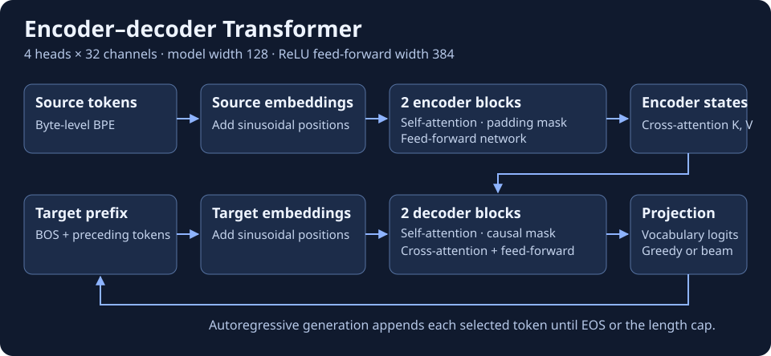

# Transformer

**An End-to-End Implementation of the Original Transformer Architecture**

A PyTorch implementation of the encoder–decoder Transformer inspired by *Attention Is All You Need*. The project implements multi-head attention, sinusoidal positions, causal masking, sequence-to-sequence training, and autoregressive decoding from scratch. It includes a frozen checkpoint and reproducible evaluation. The model configuration, data, and training scale are specific to this project. [Vaswani et al., 2017](https://arxiv.org/abs/1706.03762)



## Overview

The encoder turns a source sequence into contextual representations. The decoder conditions on those representations and the preceding target tokens to predict the next token. The repository follows that path from tokenization and batching to loss, optimizer state, generation, and inspection in a browser.

## Key engineering highlights

- **Model implementation.** Learned query, key, and value projections, scaled dot-product attention, causal and padding masks, residual connections, layer normalization, and position-wise feed-forward networks.
- **Training and inference.** Byte-level BPE, teacher forcing, masked cross-entropy, AdamW, learning-rate scheduling, gradient clipping, and optimizer-boundary checkpoint resume. Greedy and beam search share the same model and tokenizer.
- **Evaluation and inspection.** Frozen splits, checkpoint and tokenizer verification, a Python inference server, and a web frontend for comparing predictions and inspecting actual attention tensors.

## System architecture

Tokens from a shared BPE vocabulary pass through separate source and target embeddings. The encoder builds contextual source states, and each decoder block uses those states in cross-attention. A linear vocabulary projection converts decoder states to logits. The training path supplies a shifted reference prefix. The inference path feeds generated tokens back to the decoder. [Architecture and tensor flow](transformer-from-scratch/docs/ARCHITECTURE.md)

## Inside the Transformer

### From Paper to Implementation

| Concept | Repository implementation |
|---|---|
| Scaled dot-product attention | [`ScaledDotProductAttention`](transformer-from-scratch/src/model/attention.py) scores projected queries against keys and handles fully masked rows. |
| Multi-head attention | [`SingleAttentionHead`](transformer-from-scratch/src/model/attention_head.py) learns Q, K, and V projections. [`MultiHeadAttention`](transformer-from-scratch/src/model/multi_head_attention.py) concatenates head outputs and projects them back to model width. |
| Sinusoidal positions | [`SinusoidalPositionalEncoding`](transformer-from-scratch/src/model/positional_encoding.py) adds fixed sine and cosine features to embeddings. |
| Encoder and decoder blocks | The [encoder](transformer-from-scratch/src/model/encoder_block.py) uses bidirectional self-attention. The [decoder](transformer-from-scratch/src/model/decoder_block.py) uses masked self-attention followed by cross-attention. Both apply residual addition, post-layer normalization, and a position-wise ReLU network. |
| Causal and padding masks | [Mask builders](transformer-from-scratch/src/data/masks.py) exclude future target positions and padding keys. |
| Encoder–decoder training and generation | [`EncoderDecoderTransformer`](transformer-from-scratch/src/model/transformer.py) returns token logits. [`TransformerTrainer`](transformer-from-scratch/src/training/trainer.py) optimizes the shifted targets. [Greedy](transformer-from-scratch/src/inference/greedy.py) and [beam](transformer-from-scratch/src/inference/beam_search.py) decoding start at BOS and stop at EOS or the generation cap. |

## Mathematical foundations

**Attention(Q, K, V) = softmax(QKᵀ / √dₖ)V**

The scale factor controls the magnitude of the logits before softmax over the keys. The implementation masks disallowed keys before softmax and zeros their attention weights. For cross-attention, the decoder supplies Q and the encoder supplies K and V. The weights have shape `[batch, heads, target_length, source_length]`.

Encoder self-attention sees all valid source positions. Decoder self-attention sees valid target positions up to the current query. Cross-attention sees valid source positions at each target position.

## Model specifications

| Component | Released checkpoint |
|---|---|
| Architecture | Encoder–decoder Transformer with post-layer normalization |
| Trainable parameters | 1,126,656 |
| Encoder and decoder layers | 2 each |
| Attention heads | 4 per attention layer, 32 channels per head |
| Model and feed-forward widths | 128 and 384 |
| Tokenizer and positions | Shared 874-token byte-level BPE, 64 positions per sequence |
| Initialization | Random weights |
| Selected checkpoint | Epoch 11, optimizer step 1,980 |
| Interactive decoding | Greedy and beam search with width 4 |

## Training pipeline

The generator creates parallel pairs and assigns them to disjoint split groups. The tokenizer fits only on the 8,597 training pairs. Teacher forcing uses the shifted reference prefix to predict the next token. Cross-entropy excludes padding labels. Backpropagation computes gradients, which are clipped to a norm of 1.0 before the AdamW update. The learning rate warms up and then decays with an inverse-square-root schedule.

The run ended after 16 epochs. Validation loss selected epoch 11, and the frozen checkpoint was carried forward to held-out evaluation. Checkpoints preserve optimizer and scheduler state, progress, and experiment fingerprints for resume. [Training configuration](transformer-from-scratch/configs/interview_training.yaml) · [Artifact manifest](transformer-from-scratch/assets/release/README.md)

## Experimental results

### Demonstration Task

**English → Hindi translation** provides a controlled sequence-to-sequence benchmark for training and testing the custom model. The corpus uses synthetic conversational patterns to test familiar structures, new combinations of their slots, and withheld constructions.

| Synthetic split | What it measures | Exact match | chrF2 | BLEU | EOS |
|---|---|---:|---:|---:|---:|
| In-domain validation | Held-out rows from familiar patterns used during checkpoint selection | 1,079/1,088 (99.17%) | 99.81 | 99.61 | 1,088/1,088 |
| Held-out composition | New combinations of familiar construction elements | 1,621/1,642 (98.72%) | 99.68 | 99.31 | 1,639/1,642 |
| Held-out lexical combinations | Reserved combinations of lexical items | 2,399/2,434 (98.56%) | 99.92 | 99.24 | 2,434/2,434 |
| Withheld structures | Entire question families excluded from training | 330/433 (76.21%) | 87.44 | 83.24 | 428/433 |

Results use greedy decoding from the frozen checkpoint. Exact match compares a full sequence with one synthetic reference. chrF2 and BLEU report surface overlap, and EOS counts sequences that emitted the end token. These results describe the four benchmark splits. [Evaluation sources](transformer-from-scratch/docs/EXPERIMENT_RESULTS.md)

## Attention visualization

The inference server recomputes attention on the selected generated prefix with dropout disabled. The viewer supports encoder self-attention, masked decoder self-attention, cross-attention, and masks. It labels token axes and lets readers select layers and heads. These tensors show attention weights for a specific forward pass.

## Interactive demonstration

The browser interface runs actual autoregressive inference through the [Python server](transformer-from-scratch/scripts/interview_server.py). It compares greedy and beam outputs, exposes the emitted tokens, and displays training curves and validation examples. This capture shows the verified beam-width-4 prediction for “Can you help me?”


The cross-attention capture uses the same prediction. Rows represent decoder queries and columns represent source keys.


## Engineering challenges

- **Alignment and source conditioning.** Earlier corpus audits found mismatched pairs. Source swaps increased teacher-forced loss, yet generated sequences still lost names or relationships. The synthetic split design gives more specific failure cases to inspect.
- **Masking and reproducibility.** Tests cover future-token isolation, padding, gradients, EOS, and deterministic optimizer-boundary resume.
- **Decoding and generalization.** Beam search produces a valid help request where greedy decoding returns a malformed one. Both strategies still change “your” to “their” in a name question. [Error analysis](transformer-from-scratch/docs/PROJECT_REPORT.md)

## Repository structure

```text
transformer-from-scratch/
├── src/model/      Transformer layers, attention, and projection
├── src/data/       Tokenization, batching, and masks
├── src/training/   Loss, optimization, and checkpoints
├── src/inference/  Checkpoint loading and decoding
├── scripts/        Preparation, training, evaluation, and serving
├── interview_app/  Browser interface
├── tests/          Python and browser checks
├── assets/         Frozen release and presentation assets
└── docs/           Setup, architecture, and experiment reports
```

## Reproducibility

From the repository root, use Python 3.11 or later and Bash. The demo runs on CPU.

```bash
cd transformer-from-scratch
python3 -m venv .venv
.venv/bin/python -m pip install -r requirements.txt
shasum -a 256 -c assets/release/SHA256SUMS
.venv/bin/python -m zipfile -e assets/release/conversation-v2.zip experiments/conversation-v2-release
bash scripts/run_interview_demo.sh --experiment experiments/conversation-v2-release --port 8765
```

Open [localhost:8765](http://127.0.0.1:8765). The archive includes the checkpoint, tokenizer, synthetic split inventory, evaluation records, and training log. The setup guide covers fresh training, evaluation, and tests. [Getting started](transformer-from-scratch/docs/GETTING_STARTED.md)

## Documentation

- [Architecture and attention](transformer-from-scratch/docs/ARCHITECTURE.md)
- [Technical project report](transformer-from-scratch/docs/PROJECT_REPORT.md)
- [Experiment results](transformer-from-scratch/docs/EXPERIMENT_RESULTS.md)
- [Interview guide](transformer-from-scratch/docs/INTERVIEW_GUIDE.md)

## Limitations and future research

The checkpoint covers a finite grammar. Unseen names and constructions, agreement, repetition, and longer sequences remain failure modes. Independently reviewed paraphrases and contrastive examples for names, roles, and politeness would test whether the model generalizes beyond the generated template families.

## References

- Vaswani et al. (2017), [Attention Is All You Need](https://arxiv.org/abs/1706.03762).
- [PyTorch documentation](https://docs.pytorch.org/docs/stable/index.html), [Hugging Face Tokenizers](https://huggingface.co/docs/tokenizers/api/pre-tokenizers#tokenizers.pre_tokenizers.ByteLevel), and [SacreBLEU](https://github.com/mjpost/sacrebleu).

## Author, acknowledgements and license

**Keshav Kandoi.** AI tools assisted with development, debugging, and documentation. [GitHub](https://github.com/KeshavKandoi) · [Portfolio](https://keshavkandoi.me) · [LinkedIn](https://www.linkedin.com/in/keshavkandoi/)

The repository has no license file. The release archive contains locally generated data. Earlier IIT Bombay corpus experiments are separate and excluded from the release. CFILT lists CC BY-NC 4.0 for its corpus and notes distinct terms for compiled sources. [CFILT corpus page](https://www.cfilt.iitb.ac.in/iitb_parallel/) · [Corpus provenance](transformer-from-scratch/docs/CORPUS_WORKFLOW.md)
