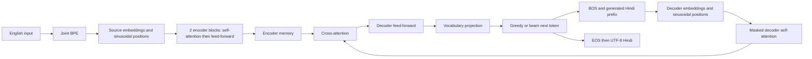

# Encoder–decoder architecture

Both encoder and decoder use model width 128, four heads of width 32, feed-forward width 384, two layers, fixed sinusoidal positions, residual connections and post-layer normalization. Each decoder block has masked self-attention, cross-attention and a feed-forward sublayer. Source and target embeddings and vocabulary projection are separate trainable matrices. The configured window is 64 positions.

For head vectors `Q, K, V`, attention is `softmax(QKᵀ / sqrt(d_k) + mask) V`. The repository implements the projections, score scaling, head splitting, masking and recombination. Masks enter as Boolean tensors with true for allowed keys. The model masks future target keys and target/source padding separately. Loss masks padding labels as well.

Train with shifted gold Hindi. Generate with the same tensors and a prefix beginning only at BOS. The app recomputes attention on BOS followed by the emitted tokens before the last prediction. Encoder rows and columns use source token labels, decoder self-attention uses decoder-input labels, and cross-attention uses decoder-input rows and English key columns. The single-sentence source mask usually has only allowed positions because no batch padding is needed.
